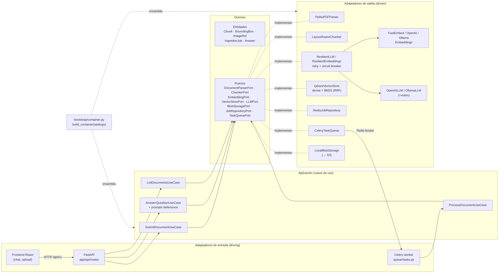
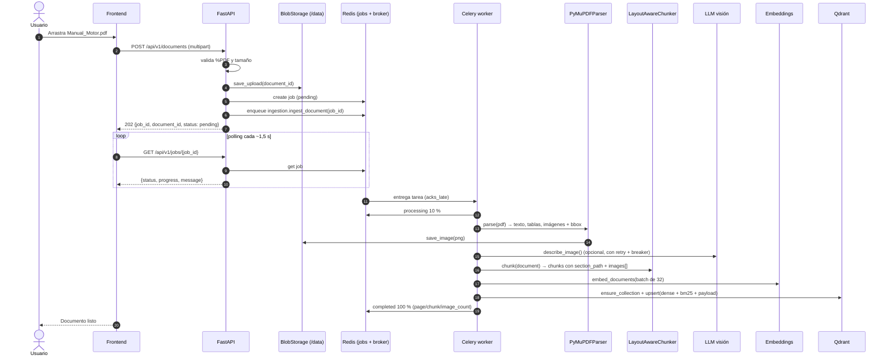
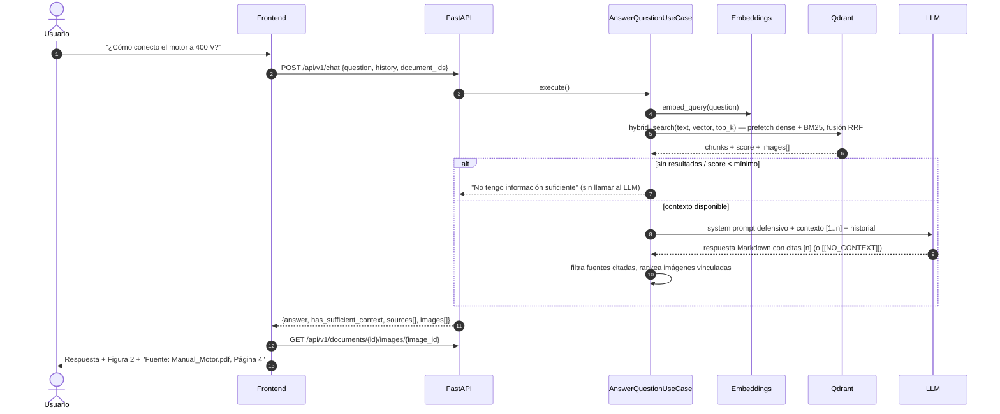

# RAG Multimodal para Manuales Técnicos

Sistema de *Retrieval-Augmented Generation* multimodal que permite chatear con manuales técnicos en PDF
(texto, tablas y diagramas). Ingiere los documentos de forma asíncrona, extrae texto, tablas e imágenes
con sus *bounding boxes*, los trocea respetando el layout, los indexa en Qdrant con búsqueda híbrida
(semántica + palabras clave) y responde preguntas citando la fuente exacta
(**"Fuente: Manual_Motor.pdf, Página 4"**) y mostrando los diagramas relevantes junto a la respuesta.

- **Backend:** Python 3.12 · FastAPI · Celery · Redis · Qdrant · PyMuPDF · FastEmbed · OpenAI / Ollama
- **Frontend:** React 18 · Vite · TypeScript · react-markdown
- **Infra:** Docker Compose (un solo comando), GitHub Actions

---

## Índice

1. [Inicio rápido](#inicio-rápido)
2. [Cumplimiento de requisitos](#cumplimiento-de-requisitos)
3. [Arquitectura lógica](#arquitectura-lógica)
4. [Flujos: ingesta y consulta](#flujos)
5. [Configuración y entornos](#configuración-y-entornos)
6. [Referencia de la API](#referencia-de-la-api)
7. [Tests y calidad](#tests-y-calidad)
8. [Estructura del proyecto](#estructura-del-proyecto)
9. [Resiliencia y observabilidad](#resiliencia-y-observabilidad)
10. [Escalabilidad: ¿qué pasa con 100 manuales?](#escalabilidad-qué-pasa-con-100-manuales)
11. [Registro de decisiones técnicas](#registro-de-decisiones-técnicas)
12. [Limitaciones y próximos pasos](#limitaciones-y-próximos-pasos)
13. [Demo](#demo)

---

## Inicio rápido

Requisitos: Docker (con Compose v2). Nada más.

```bash
git clone <repo> && cd LA_FORTUNA
cp .env.example .env
# Opción A – OpenAI: edita .env y pon OPENAI_API_KEY=sk-...
docker compose up --build
```

**Opción B – 100 % local con Ollama (sin claves):**

```bash
cp .env.example .env
# en .env:  LLM_PROVIDER=ollama   (EMBEDDING_PROVIDER=fastembed ya es local)
docker compose --profile ollama up --build -d
# el servicio one-shot `ollama-pull` descarga OLLAMA_CHAT_MODEL (gemma3:4b, ~3.3 GB) automáticamente:
docker compose logs -f ollama-pull
docker compose exec ollama ollama pull nomic-embed-text    # solo si EMBEDDING_PROVIDER=ollama
```

> `gemma3:4b` es multimodal (describe diagramas en la ingesta), maneja bien español y corre en CPU con ~8 GB
> asignados a Docker. Con GPU, modelos mayores (`gemma3:12b`, `llama3.2-vision`) dan mejores respuestas.

> Para usar un Ollama que ya corre en tu máquina: `DOCKER_OLLAMA_BASE_URL=http://host.docker.internal:11434 docker compose up`.

| Servicio | URL |
|---|---|
| Interfaz de chat | http://localhost:3000 |
| API (Swagger / OpenAPI) | http://localhost:8000/docs |
| Health / readiness | http://localhost:8000/health · http://localhost:8000/api/v1/health/ready |
| Dashboard de Qdrant | http://localhost:6333/dashboard |

Prueba con el manual de ejemplo incluido (`docs/sample/Manual_Motor.pdf`, motor ficticio MTX-450,
6 páginas con tablas, una figura raster y un esquema vectorial):

```bash
bash scripts/demo.sh            # sube el PDF, espera al job y hace una pregunta
# o desde la UI: arrastra el PDF y pregunta, p. ej.
#   "¿Cada cuántas horas se relubrican los rodamientos y con cuánta grasa?"
#   "¿Cómo se conecta el motor a una red de 400 V?"            (→ Figura 2)
#   "¿Qué hago si dispara la sonda PTC?"
#   "¿Cuál es el precio del motor?"                             (→ "No tengo información suficiente")
```

Atajos (`make help`): `make up`, `make up-ollama`, `make down`, `make logs`, `make test`, `make lint`,
`make sample-pdf`, `make demo`, `make dev-infra`, `make dev-api`, `make dev-worker`.

---

## Cumplimiento de requisitos

| Requisito del reto | Implementación | Dónde |
|---|---|---|
| Arquitectura limpia / hexagonal | Dominio puro + puertos ABC; casos de uso dependen solo de puertos; adaptadores en infraestructura | `app/domain/ports.py`, `app/application/`, `app/infrastructure/` — [ADR 0001](docs/adr/0001-hexagonal-architecture.md) |
| Inyección de dependencias, cambiar OpenAI ↔ Ollama | *Composition root* que elige adaptadores por configuración (`LLM_PROVIDER`, `EMBEDDING_PROVIDER`) | `app/bootstrap/container.py` (`build_container`) |
| `.env` por entorno | `pydantic-settings` tipado; `.env` + overlay `.env.<APP_ENV>`; variables reales con prioridad | `app/core/config.py`, `.env.example` |
| Ingesta asíncrona con `job_id` + endpoint de estado | `POST /documents` → 202 + `job_id`; Celery worker; `GET /jobs/{job_id}` con progreso | `app/application/ingestion.py`, `app/infrastructure/queue/`, `app/api/routes/` — [ADR 0004](docs/adr/0004-async-ingestion-celery-redis.md) |
| Extracción multimodal con *bounding boxes* | PyMuPDF: bloques de texto (fuente, negrita), tablas → Markdown, imágenes + bbox + pie de figura; descripción opcional con LLM de visión | `app/infrastructure/parsing/` (`PyMuPDFParser`) |
| Chunking por layout / semántico | Por encabezados con `section_path`, oraciones completas, tablas íntegras, chunk por imagen | `app/infrastructure/chunking/layout_chunker.py` — [ADR 0003](docs/adr/0003-layout-aware-chunking.md) |
| Base de datos vectorial | Qdrant con vectores nombrados `dense` + `bm25`, índice por `document_id` | `app/infrastructure/vectorstore/qdrant_store.py` — [ADR 0002](docs/adr/0002-vector-db-qdrant-hybrid-search.md) |
| Recuperación híbrida (semántica + keywords) | Query API de Qdrant: prefetch denso + BM25 fusionados con RRF | `QdrantVectorStore.hybrid_search` |
| Detectar imágenes vinculadas a los chunks | Proximidad espacial de bbox en la misma página + referencias "Figura N"; ranking por relevancia | `layout_chunker.py`, `app/application/query.py` — [ADR 0007](docs/adr/0007-image-text-spatial-linking.md) |
| Prompting defensivo / anti-alucinación | Guardia pre-LLM, contexto numerado, citas `[n]`, marcador `[[NO_CONTEXT]]`, anti *prompt injection*, temperatura 0 | `app/application/prompts.py`, `app/application/query.py` — [ADR 0006](docs/adr/0006-defensive-prompting.md) |
| Tests unitarios con mocks | Pytest con *fakes* de puertos, `fakeredis`, clientes HTTP simulados; sin red | `backend/tests/unit/{api,ingestion,rag}` |
| Retry con backoff exponencial | `retry_with_backoff` / `RetryPolicy` con jitter, solo sobre `TransientError` | `app/infrastructure/resilience/retry.py` — [ADR 0005](docs/adr/0005-resilience-retry-circuit-breaker.md) |
| Circuit breaker | `CircuitBreaker` CLOSED/OPEN/HALF_OPEN; decoradores `ResilientLLM` / `ResilientEmbeddings`; 503 si abierto | `app/infrastructure/resilience/` |
| Logging | Logs estructurados JSON con `request_id` / `job_id`, middleware de acceso con latencia | `app/core/logging.py`, `app/api/middleware.py` |
| UI de chat con Markdown | React + `react-markdown` + GFM (tablas) | `frontend/src/components/MarkdownAnswer.tsx` |
| Imágenes junto a la respuesta | Tarjetas de figura con pie, página y *lightbox* | `frontend/src/components/FigureCard.tsx`, `Lightbox.tsx` |
| Metadatos de fuente | "Fuente: Manual_Motor.pdf, Página N" por cita | `frontend/src/components/SourcesList.tsx` |
| Docker Compose (api, frontend, qdrant, redis, worker) | Un comando, healthchecks, volúmenes, perfil `ollama` opcional | `docker-compose.yml`, `backend/Dockerfile`, `frontend/Dockerfile` |
| Commits semánticos | Convención *Conventional Commits* (`feat:`, `fix:`, `docs:`, `test:`, `chore:`...) | historial de git |
| README + diagrama + decisiones + setup + tests + demo | Este documento, [docs/architecture.md](docs/architecture.md), [docs/adr](docs/adr/) | — |

---

## Arquitectura lógica

Arquitectura hexagonal: los **adaptadores de entrada** (API REST y worker Celery) invocan **casos de
uso** de la capa de aplicación, que solo conocen **puertos** (interfaces del dominio). Los
**adaptadores de salida** implementan esos puertos y se ensamblan en `app/bootstrap/container.py`.



Más detalle (despliegue, modelo de datos, mapa de módulos): [docs/architecture.md](docs/architecture.md).

---

## Flujos

### Ingesta (asíncrona)



### Consulta (chat)



---

## Configuración y entornos

Toda la configuración vive en `app/core/config.py` (`Settings`, `pydantic-settings`); cada campo se
mapea a una variable de entorno en mayúsculas. [`.env.example`](.env.example) documenta todas,
agrupadas (App, Infraestructura, LLM, Embeddings, Ingesta, Recuperación, Resiliencia).

Orden de precedencia (de menor a mayor):

1. Valores por defecto de `Settings`.
2. `.env`
3. `.env.<APP_ENV>` — *overlay* por entorno (`APP_ENV=development|test|production`), p. ej.
   `.env.production` con `LOG_LEVEL=WARNING` o `.env.test` con `LLM_PROVIDER=ollama`.
4. Variables de entorno reales del proceso/contenedor (en `docker-compose.yml` se fuerzan
   `REDIS_URL`, `QDRANT_URL`, `DATA_DIR` y `OLLAMA_BASE_URL` a los nombres de servicio internos).

Variables clave:

| Variable | Valores | Efecto |
|---|---|---|
| `LLM_PROVIDER` | `openai` \| `ollama` | Modelo de chat y de visión (descripción de imágenes) |
| `EMBEDDING_PROVIDER` | `fastembed` (defecto) \| `openai` \| `ollama` | Vectores densos. Al cambiarlo, usa otra `QDRANT_COLLECTION` y re-ingesta |
| `DESCRIBE_IMAGES` | `true` \| `false` | Describir imágenes con el LLM de visión durante la ingesta |
| `RETRIEVAL_TOP_K`, `MAX_IMAGES_PER_ANSWER` | enteros | Contexto y nº de imágenes por respuesta |
| `RETRY_*`, `CIRCUIT_*` | números | Política de reintentos y circuit breaker |

---

## Referencia de la API

Prefijo `/api/v1`. Documentación interactiva en http://localhost:8000/docs.

| Método | Ruta | Descripción | Respuesta |
|---|---|---|---|
| `POST` | `/documents` | Sube un PDF (campo multipart `file`) | **202** `{job_id, document_id, filename, status}` |
| `GET` | `/jobs/{job_id}` | Estado de la ingesta | `{job_id, document_id, filename, status: pending\|processing\|completed\|failed, progress, message, error, page_count, chunk_count, image_count, created_at, updated_at}` |
| `GET` | `/documents` | Documentos indexados | `[{document_id, filename, page_count, chunk_count, image_count, created_at}]` |
| `GET` | `/documents/{document_id}/images/{image_id}` | Imagen extraída (PNG, cache inmutable) | bytes |
| `POST` | `/chat` | Pregunta `{question, history: [{role, content}], document_ids: [..] \| null}` | `{answer, has_sufficient_context, sources: [...], images: [...]}` |
| `GET` | `/health` | *Liveness* (también fuera del prefijo) | `{"status": "ok"}` |
| `GET` | `/health/ready` | *Readiness*: comprueba Redis y Qdrant | 200 / 503 |

Ejemplo:

```bash
curl -F "file=@docs/sample/Manual_Motor.pdf" http://localhost:8000/api/v1/documents
# {"job_id":"...","document_id":"...","filename":"Manual_Motor.pdf","status":"pending"}

curl http://localhost:8000/api/v1/jobs/<job_id>

curl -X POST http://localhost:8000/api/v1/chat -H "Content-Type: application/json" \
  -d '{"question":"¿Qué grasa se usa en los rodamientos?","history":[]}'
```

Respuesta de `/chat` (abreviada):

```json
{
  "answer": "Se usa grasa de litio NLGI 3: 20 g en el lado LA y 15 g en el lado LOA cada 4000 h [1].",
  "has_sufficient_context": true,
  "sources": [{"chunk_id": "...", "document_id": "...", "document_name": "Manual_Motor.pdf",
               "page": 5, "score": 0.83, "snippet": "Relubricación de rodamientos | 4000 h | ...",
               "bbox": [56.0, 520.1, 539.3, 690.4]}],
  "images": [{"image_id": "..._p3_i0", "document_name": "Manual_Motor.pdf", "page": 3,
              "caption": "Figura 1: Vista explosionada del motor MTX-450...",
              "url": "/api/v1/documents/<document_id>/images/<image_id>", "relevance": 0.61, "...": "..."}]
}
```

Errores: `{"error": {"code", "message", "request_id"}}` — 404 no encontrado, 422 validación (p. ej.
fichero que no es PDF), 503 circuito abierto, 502 fallo del proveedor externo.

---

## Tests y calidad

Los tests unitarios se ejecutan **offline**: los puertos se sustituyen por *fakes* / mocks
(Redis con `fakeredis`, Qdrant/OpenAI/Ollama simulados), así que no necesitan Docker ni claves.

```bash
# Backend
cd backend
python -m venv .venv && source .venv/bin/activate     # Windows: .venv\Scripts\activate
pip install -e ".[dev]"
python -m pytest                                      # o: make test-backend (con cobertura)
ruff check .

# Frontend
cd frontend
npm ci
npm test -- --run
npm run typecheck && npm run build
```

`make test` ejecuta ambos. La CI (`.github/workflows/ci.yml`) corre ruff + pytest con cobertura,
typecheck + tests + build del frontend y la build de ambas imágenes Docker.

Áreas cubiertas (`backend/tests/unit/`):

- `ingestion/` — parser sobre PDFs sintéticos, chunker (encabezados, tablas íntegras, vínculo imagen-texto por distancia y por "Figura N"), validación de subida, transiciones del job.
- `rag/` — retry/backoff, circuit breaker (reloj inyectado), decoradores resilientes, adaptadores OpenAI/Ollama (mapeo de errores), Qdrant store, caso de uso de consulta (guardia sin contexto, citas, selección de imágenes).
- `api/` — rutas, códigos HTTP, manejadores de error, contenedor DI.

**Resultado actual:** 251 tests unitarios del backend en verde (~30 s, sin red) con **95 % de cobertura** de líneas sobre `app/`; 22 tests del frontend (Vitest + Testing Library).

### Desarrollo local sin Docker para api/worker

```bash
make dev-infra     # solo qdrant + redis en Docker
make dev-api       # uvicorn --reload en :8000
make dev-worker    # celery (en Windows usa --pool=solo, ya incluido)
cd frontend && npm run dev   # Vite en :5173 con proxy /api → :8000
```

---

## Estructura del proyecto

```
.
├── backend/
│   ├── app/
│   │   ├── domain/            # entidades, puertos, excepciones (sin dependencias)
│   │   ├── application/       # casos de uso + prompts defensivos
│   │   ├── infrastructure/    # parsing, chunking, embeddings, llm, vectorstore,
│   │   │                      # storage, jobs, queue (Celery), resilience
│   │   ├── bootstrap/         # contenedor DI (composition root)
│   │   ├── api/               # FastAPI: routes, schemas, errors, middleware
│   │   └── core/              # config (pydantic-settings) y logging estructurado
│   ├── tests/unit/            # api/ · ingestion/ · rag/
│   ├── Dockerfile             # multi-stage, non-root, modelos FastEmbed precargados
│   └── pyproject.toml
├── frontend/                  # React + Vite + TS, servido por nginx en Docker
│   └── src/{api,components,hooks,lib}
├── docs/
│   ├── adr/                   # registro de decisiones técnicas
│   ├── architecture.md
│   └── sample/Manual_Motor.pdf
├── scripts/
│   ├── generate_sample_pdf.py # genera el manual de ejemplo (solo PyMuPDF)
│   └── demo.sh                # demo end-to-end con curl
├── docker-compose.yml
├── .env.example
├── Makefile
└── .github/workflows/ci.yml
```

---

## Resiliencia y observabilidad

- **Reintentos con backoff exponencial + jitter** solo para errores transitorios (429, 5xx, timeouts,
  conexión). Los errores permanentes (401, 400) fallan rápido.
- **Circuit breaker** por proveedor (LLM y embeddings): tras `CIRCUIT_FAILURE_THRESHOLD` fallos se abre
  y responde 503 inmediatamente durante `CIRCUIT_RECOVERY_SECONDS`; después pasa a HALF_OPEN y prueba.
- Ambos son **decoradores de puertos** (`ResilientLLM`, `ResilientEmbeddings`): la lógica de negocio no
  cambia y aplican igual a OpenAI que a Ollama.
- **Celery:** `acks_late` + `reject_on_worker_lost` (un worker que muere no pierde la tarea),
  `prefetch=1`; el job queda en `failed` con el error visible en la UI si la ingesta falla.
- **Healthchecks** en todos los servicios y `depends_on: service_healthy`; `/health/ready` comprueba
  Redis y Qdrant.
- **Logging estructurado JSON** con `request_id` (cabecera `X-Request-ID`) y `job_id` en contexto,
  latencia por petición, reintentos y cambios de estado del circuito.

---

## Escalabilidad: ¿qué pasa con 100 manuales?

100 manuales de ~200 páginas ≈ 20 000 páginas ≈ 60–100 k chunks: un volumen modesto para Qdrant
(cabe holgadamente en memoria de un nodo; 100k × 384 dim × 4 B ≈ 150 MB de vectores densos). El cuello
de botella está en la **ingesta** (parseo, descripción de imágenes con LLM y embeddings), no en la consulta.

| Aspecto | Estrategia |
|---|---|
| Throughput de ingesta | Workers Celery sin estado y escalables horizontalmente: `docker compose up --scale worker=8` (o HPA en Kubernetes por longitud de cola). `concurrency` ajustable por CPU. |
| Backpressure | La cola `ingestion` en Redis absorbe picos; `prefetch_multiplier=1` reparte tareas largas de forma justa; la API sigue respondiendo 202 al instante. Límite de tamaño por subida (`MAX_UPLOAD_MB`). |
| Idempotencia | Cada job procesa un `document_id`; los ids de punto son deterministas, así que un reintento o reproceso sobrescribe en lugar de duplicar. `acks_late` garantiza re-entrega si un worker muere. |
| Coste de embeddings / visión | Embeddings en lotes (`EMBEDDING_BATCH_SIZE`), FastEmbed local sin coste por token; la descripción de imágenes es opcional (`DESCRIBE_IMAGES`) y protegida por retry + circuit breaker frente a rate limits. |
| Búsqueda | Qdrant con índice de payload sobre `document_id` para filtrar por manual; HNSW para el vector denso y índice invertido para BM25. Para millones de chunks: *sharding* y réplicas de Qdrant, cuantización escalar/binaria. |
| API | Sin estado (todo en Redis/Qdrant/blob storage) → réplicas detrás de un balanceador. |
| Almacenamiento de ficheros | `BlobStoragePort`: el volumen local se sustituye por un adaptador S3/MinIO (servido vía URLs firmadas/CDN) sin tocar los casos de uso. |
| Jobs | Redis con TTL; para auditoría o multi-tenant, `JobRepositoryPort` sobre PostgreSQL. |
| Calidad con más documentos | Más candidatos compiten: filtro por `document_ids` desde la UI, re-ranking con *cross-encoder* sobre el top-k híbrido y metadatos (modelo de equipo, versión) como filtros de payload. |

---

## Registro de decisiones técnicas

Cada decisión relevante tiene un ADR (contexto, decisión, alternativas, consecuencias) en
[docs/adr/](docs/adr/):

| ADR | Decisión | Resumen |
|---|---|---|
| [0001](docs/adr/0001-hexagonal-architecture.md) | Arquitectura hexagonal + DI manual | Dominio puro, puertos ABC, `build_container` elige OpenAI/Ollama por configuración; sin LangChain para mantener control y testabilidad. |
| [0002](docs/adr/0002-vector-db-qdrant-hybrid-search.md) | Qdrant + búsqueda híbrida RRF | Vectores `dense` + `bm25` en el mismo punto; fusión RRF en servidor; captura términos exactos (códigos, IP55) y paráfrasis. |
| [0003](docs/adr/0003-layout-aware-chunking.md) | Chunking por layout | Encabezados → `section_path`, oraciones completas, tablas íntegras en Markdown, chunk por imagen. |
| [0004](docs/adr/0004-async-ingestion-celery-redis.md) | Ingesta asíncrona Celery + Redis | 202 + `job_id`, progreso en Redis, `acks_late`, workers escalables. |
| [0005](docs/adr/0005-resilience-retry-circuit-breaker.md) | Retry + circuit breaker | Decoradores de puertos; solo errores transitorios se reintentan; 503 con circuito abierto. |
| [0006](docs/adr/0006-defensive-prompting.md) | Prompting defensivo | Guardia pre-LLM, citas `[n]`, `[[NO_CONTEXT]]`, contexto tratado como datos, temperatura 0. |
| [0007](docs/adr/0007-image-text-spatial-linking.md) | Vínculo imagen ↔ texto | Distancia entre bbox en la misma página + referencias "Figura N"; ranking `score / (1 + d/100)`. |
| [0008](docs/adr/0008-embeddings-provider-fastembed-default.md) | FastEmbed por defecto | Embeddings locales en CPU, modelos precargados en la imagen; OpenAI/Ollama intercambiables. |

---

## Limitaciones y próximos pasos

- **PDFs escaneados:** no hay OCR; añadir un adaptador `DocumentParserPort` con Tesseract/docling.
- **Diagramas vectoriales:** `PyMuPDFParser` agrupa los dibujos con `page.cluster_drawings()` y rasteriza
  la región a PNG (144 dpi) cuando parece un diagrama (≥ 5 trazos, ≥ 48 pt por lado, sin solapar tablas);
  así la Figura 2 del manual de ejemplo se recupera como imagen. Es una heurística: diagramas muy
  dispersos o mezclados con texto pueden fragmentarse.
- **Modelo de embeddings en inglés** por defecto (`bge-small-en`); para corpus en español usar uno
  multilingüe (`intfloat/multilingual-e5-large`, `BAAI/bge-m3`) o `EMBEDDING_PROVIDER=openai`.
- **Re-ranking:** añadir un *cross-encoder* tras la fusión RRF para mejorar la precisión del top-k.
- **Evaluación:** conjunto de preguntas doradas y métricas (faithfulness, context recall) con RAGAS
  en CI.
- **Streaming** de la respuesta (SSE) y progreso de ingesta por WebSocket.
- **Seguridad:** autenticación/autorización y multi-tenant (filtro por tenant en payload), límite de
  peticiones, escaneo antivirus de subidas.
- **Estado del circuit breaker** compartido entre réplicas (Redis) y métricas Prometheus/OpenTelemetry.
- **Borrado de documentos** expuesto en la API (`VectorStorePort.delete_document` ya existe).

---

## Demo

<!-- TODO(integrador): enlazar vídeo/GIF de la demo (subida del PDF → progreso → pregunta → respuesta con Figura y fuente). -->

**Vídeo:** _pendiente_ — TODO

Guion de la demo:

1. `docker compose up --build` y abrir http://localhost:3000.
2. Subir `docs/sample/Manual_Motor.pdf` y ver el progreso del job (pending → processing → completed).
3. Preguntar "¿Cómo se conecta el motor a una red de 400 V?" → respuesta en Markdown con citas, la
   **Figura 2** (esquema de conexión) al lado y "Fuente: Manual_Motor.pdf, Página 4".
4. Preguntar "¿Cuáles son los componentes principales?" → **Figura 1** (vista explosionada).
5. Preguntar "¿Cuál es el precio del motor?" → "No tengo información suficiente…" (sin alucinar).
6. Apagar el LLM (o poner una clave inválida) y mostrar el circuit breaker respondiendo 503 rápido.
