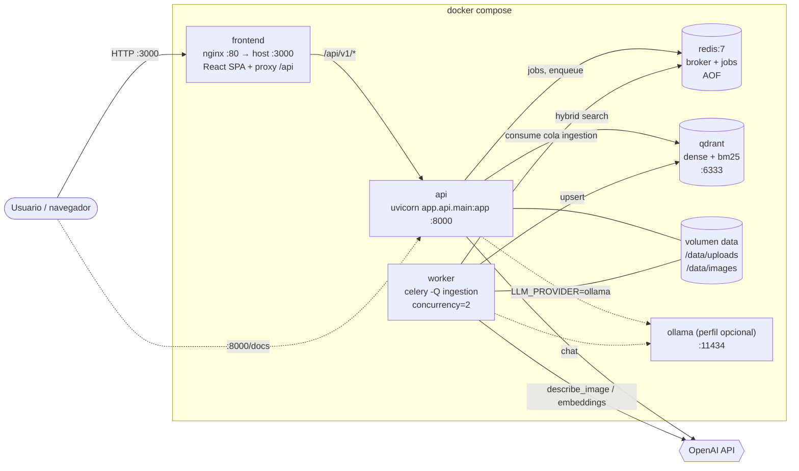

# Arquitectura

Complementa al [README](../README.md) (vista lógica y diagramas de secuencia) con la vista de
despliegue, el modelo de datos y el mapa de módulos.

## 1. Vista de despliegue (docker-compose)



- `api` y `worker` usan **la misma imagen** (`backend/Dockerfile`) con distinto `command`.
- `api` y `worker` comparten el volumen `data` (PDF originales e imágenes extraídas). En un despliegue
  multi-nodo este volumen se sustituye por un adaptador S3/MinIO de `BlobStoragePort`.
- Healthchecks: `redis-cli ping`, `GET /readyz` de Qdrant, `GET /health` de la API y
  `celery inspect ping` del worker; los servicios arrancan con `depends_on: condition: service_healthy`.

## 2. Modelo de datos

### Punto en Qdrant (colección `QDRANT_COLLECTION`)

| Campo | Contenido |
|---|---|
| vector `dense` | embedding del texto del chunk (FastEmbed/OpenAI/Ollama) |
| vector `bm25` | vector sparse BM25 (FastEmbed `Qdrant/bm25`, modificador IDF) |
| payload | chunk completo: `chunk_id`, `document_id` (indexado), `document_name`, `text`, `page_start`, `page_end`, `bbox`, `chunk_type` (`text`/`table`/`image`), `section_path`, `images[]` (`image_id`, `page`, `bbox`, `distance`, `caption`) |

### Job de ingesta (Redis, TTL 7 días)

`IngestionJob`: `job_id`, `document_id`, `filename`, `file_path`, `status`
(`pending → processing → completed | failed`), `progress` 0–100, `message`, `error`,
`page_count`, `chunk_count`, `image_count`, `created_at`, `updated_at`.

### Ficheros (volumen `/data`)

```
/data/uploads/{document_id}.pdf
/data/images/{document_id}/{document_id}_p{page}_i{index}.png
```

## 3. Mapa de módulos

```
backend/app/
├── domain/            # entidades, puertos (ABC), excepciones — sin dependencias externas
├── application/       # casos de uso (ingestion, query, documents) + prompts
├── infrastructure/
│   ├── parsing/       # PyMuPDFParser (texto, tablas, imágenes + bbox, captions)
│   ├── chunking/      # LayoutAwareChunker
│   ├── embeddings/    # FastEmbed / OpenAI / Ollama
│   ├── llm/           # OpenAI / Ollama (+ visión)
│   ├── vectorstore/   # QdrantVectorStore (híbrido RRF)
│   ├── storage/       # LocalBlobStorage
│   ├── jobs/          # RedisJobRepository / InMemoryJobRepository
│   ├── queue/         # celery_app, tasks, CeleryTaskQueue
│   └── resilience/    # retry, circuit breaker, decoradores Resilient*
├── bootstrap/         # Container + build_container(settings) (composition root)
├── api/               # FastAPI: routes, schemas, errors, middleware
└── core/              # config (pydantic-settings), logging estructurado
```

Regla de dependencias: `domain` ← `application` ← `infrastructure` / `api`; solo `bootstrap`
conoce las clases concretas. Las decisiones están detalladas en [docs/adr](adr/).
